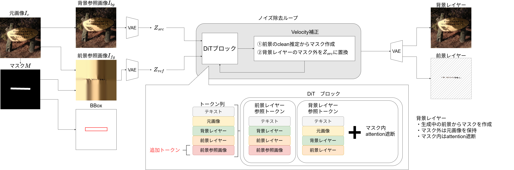

# RevealLayer-TextRemoval: Training-free Scene Text Removal by Layer Decomposition

[](https://github.com/ito127/RevealLayer-TextRemoval/actions/workflows/tests.yml)
[](LICENSE)

Training-free, single-pass scene text removal built on
[RevealLayer](https://github.com/360CVGroup/RevealLayer) (ICML 2026).



<sub>Method overview (labels in Japanese). Left: the input image I<sub>c</sub>, the text mask M and its BBox, the
background reference image I<sub>bg</sub> (the text filled from the surrounding colours) and the foreground
reference image I<sub>fg</sub> (the text alone). Middle: the denoising loop, in which a velocity correction
(① build the text mask from the text layer's clean estimate, ② replace the background layer outside the mask with
Z<sub>src</sub>) follows every DiT pass. Bottom: the tokens of one DiT block. The foreground reference image is added
as extra tokens that only the text layer reads, and the background layer's attention to the text inside the mask
is blocked. Right: the output background layer (the text-free image) and foreground (text) layer.
Z<sub>src</sub> is the VAE latent of the input image I<sub>c</sub>.</sub>

## Abstract

Scene text removal erases the text in an image and fills the region with a plausible background. Dedicated text
removal models are trained on paired data, and general diffusion inpainting models tend to draw new text into the
masked region. We instead use RevealLayer, an occlusion-aware image decomposition model that recovers the content
hidden behind each object, and treat the text as the object: the recovered background layer is the text-free image.
Applied as is, RevealLayer fails in two ways. The background layer copies the text from the full-image layer it
attends to, and it drifts away from the input outside the text. We change only the inference of the pretrained
model: the text layer and the background read separate reference images, a velocity correction keeps the
background equal to the input outside the text, and the background's attention to the text tokens is blocked.
The text mask used by both is taken from the text layer at every denoising step, so one run is enough and no
training is needed. On the SCUT-EnsText test set (813 images), the method reaches 44.06 dB PSNR in the main
setting, higher than every diffusion-based inpainting baseline we compare (ASUKA, OSOR, FLUX.1-Fill, RePaint) and
second only to ViTEraser, a dedicated model trained on SCUT-EnsText.

## Contributions

- **Text removal as layer decomposition.** The text-free image is the background layer of a pretrained RevealLayer
  model. There is no fine-tuning and no extra model, and the text layer comes out of the same run.
- **A text mask that follows the model.** From step 1 on, the mask is the region where the text layer's clean
  estimate is not transparent. The keep and the blocking both use it, so a single denoising run is enough.
- **Background keep by velocity correction.** Outside the dilated mask, the velocity is corrected so that the
  background's clean estimate equals the latent of the input image. The background outside the text is preserved
  without a second pass.
- **Attention blocking and separate references.** The text tokens under the mask are hidden from the background
  queries through the attention mask of all 19 MMDiT and 38 single-stream blocks. The text layer reads an image
  that contains only the text, and the background reads an image in which the text is already roughly filled in.
- **Evaluation code.** SCUT-EnsText targets, the official ViTEraser metrics, FID, tables and figures, for two text
  scopes and two evaluation targets (below).

Details: [docs/METHOD.md](docs/METHOD.md).

> This is a fork of [360CVGroup/RevealLayer](https://github.com/360CVGroup/RevealLayer). The upstream history is
> kept, and only the parts needed for text removal remain (see [Changes from upstream](#changes-from-upstream)).

## Results

SCUT-EnsText test set (813 images, 512×512), official ViTEraser metrics and FID. In the main setting
(**largest_text**), only the largest connected text region of each image is removed. Its GT is the official
text-removed image inside that region and the input image outside it.

The output is evaluated in two ways:

| Target | Inside the evaluated text region | Outside it | What it measures |
|---|---|---|---|
| **paste** | method output | GT | the removal itself |
| **raw** | method output | method output | the removal and any change outside the text |

Our model runs at 1024 px and regenerates the whole image, so its raw score also counts the small differences that
this causes outside the text. ViTEraser and ConText erase every text in the image, so they have no largest_text raw
result.

**largest_text, paste** (all 813 images):

| Method | PSNR↑ | MS-SSIM↑ | MSE↓ | AGE↓ | pEPS↓ | pCEPS↓ | FID↓ |
|---|---|---|---|---|---|---|---|
| Ours | 44.06 | 0.9921 | 0.00067 | 0.583 | 0.0064 | 0.0050 | 5.90 |
| ASUKA (FLUX.1-Fill) | 30.53 | 0.9743 | 0.00264 | 1.621 | 0.0180 | 0.0131 | 14.98 |
| OSOR | 39.06 | 0.9870 | 0.00129 | 0.961 | 0.0113 | 0.0087 | 7.61 |
| FLUX.1-Fill | 30.93 | 0.9726 | 0.00298 | 1.869 | 0.0208 | 0.0156 | 15.98 |
| ViTEraser | **48.58** | **0.9943** | **0.00016** | **0.285** | **0.0027** | **0.0017** | **3.19** |
| ConText | 42.23 | 0.9874 | 0.00050 | 0.481 | 0.0052 | 0.0030 | 8.34 |

**largest_text, raw** (all 813 images):

| Method | PSNR↑ | MS-SSIM↑ | MSE↓ | AGE↓ | pEPS↓ | pCEPS↓ | FID↓ |
|---|---|---|---|---|---|---|---|
| Ours | **35.22** | **0.9826** | **0.00090** | 2.796 | **0.0100** | **0.0052** | **7.06** |
| ASUKA (FLUX.1-Fill) | 30.05 | 0.9733 | 0.00270 | **2.531** | 0.0186 | 0.0135 | 15.17 |
| OSOR | 29.90 | 0.9297 | 0.00292 | 4.755 | 0.0426 | 0.0150 | 12.91 |
| FLUX.1-Fill | 27.63 | 0.9533 | 0.00349 | 5.535 | 0.0305 | 0.0158 | 18.48 |

- **paste:** ours is second after ViTEraser in PSNR, MS-SSIM and FID, and better than every diffusion-based
  inpainting baseline in all metrics. ViTEraser is trained on the SCUT-EnsText training set; our model and the
  inpainting baselines are not.
- **raw:** among the methods with a largest_text raw result, ours is best in all metrics except AGE.

The all_text setting (every text removed), the 500-image subset with RePaint, per-image PSNR and the settings of
each method are in [docs/RESULTS.md](docs/RESULTS.md).

Qualitative results (largest_text, paste): the evaluated text is outlined in red in the input. The all_text figure
is in [docs/RESULTS.md](docs/RESULTS.md#qualitative-results).


<sub>Images: SCUT-EnsText test set, shown for research comparison only.</sub>

## Installation

Tested with Python 3.10, PyTorch 2.7.1 (CUDA 12.8) and NVIDIA Blackwell GPUs.

```bash
git clone https://github.com/ito127/RevealLayer-TextRemoval.git
cd RevealLayer-TextRemoval
bash scripts/setup_env.sh            # conda env "reveallayer"; PYTORCH_CUDA=cu126 for older drivers
conda activate reveallayer
```

`setup_env.sh` installs PyTorch from the PyTorch index, then `requirements.txt` and the bundled `diffusers/`.

## Models

FLUX.1-dev is gated. Accept its license on
[Hugging Face](https://huggingface.co/black-forest-labs/FLUX.1-dev), then log in and download:

```bash
hf auth login
bash scripts/download_models.sh
```

This downloads [qihoo360/RevealLayer](https://huggingface.co/qihoo360/RevealLayer) and the diffusers-format folders
of [black-forest-labs/FLUX.1-dev](https://huggingface.co/black-forest-labs/FLUX.1-dev):

```text
models/
├── RevealLayer/        pytorch_lora_weights.safetensors, layer_pe.pt, Refiner.pt, xvae/transparent_decoder_ckpt.pth
└── FLUX.1-dev/         transformer/, vae/, text_encoder/, text_encoder_2/, tokenizer/, tokenizer_2/, scheduler/
```

Use `--models-dir` to point to checkpoints stored elsewhere.

## Usage

The input is an image and a binary text mask (white = text, same size as the image).

```bash
python scripts/remove_text.py --image path/to/image.jpg --mask path/to/mask.png \
    --scope all_text --output-dir outputs/demo --paste-back
```

`outputs/demo/<id>/` then contains the following files:

| File | Content |
|---|---|
| `bg_rgb.png` | text-free image at the RevealLayer resolution |
| `result.png` | (`--paste-back`) text-free image at the input size, with the input image outside the text mask |
| `text_layer_rgba.png` | extracted text layer |
| `metadata.json` | settings and timing |

`--scope largest_text` removes only the largest connected text region. `--save-intermediates` also saves the
per-step masks and clean-estimate previews.

For a dataset, pass a directory of images and a directory of same-named masks:

```bash
python scripts/remove_text.py --images-dir data/SCUT-EnsText/test/all_images \
    --masks-dir data/SCUT-EnsText/test/all_masks --scope largest_text \
    --output-dir outputs/scut_largest_text --shard 0 --num-shards 1
```

A sample is skipped when every requested output file exists and is not empty. A sample with missing files (for
example an interrupted run, or a rerun with `--paste-back` added) is run again, and `--overwrite` reruns all.
Failures are written to `failed.txt` and the run continues.

## Evaluation

[eval/](eval) builds the SCUT-EnsText targets and runs the official ViTEraser metrics, FID, the result tables and
the qualitative figures. See [docs/RESULTS.md](docs/RESULTS.md#reproducing). The dataset is not included: download
[SCUT-EnsText](https://github.com/HCIILAB/SCUT-EnsText) and follow its license.

The CPU unit tests run on every push ([.github/workflows/tests.yml](.github/workflows/tests.yml)). To run them
locally: `python -m unittest discover -s tests`.

## Repository layout

```text
textremoval/      the method: inputs, per-step guidance, fills, model loading
scripts/          remove_text.py (inference), setup_env.sh, download_models.sh
eval/             SCUT-EnsText evaluation (targets, metrics, tables, figures)
models/           RevealLayer model code (with the changes below)
diffusers/        the diffusers copy bundled with RevealLayer (unchanged)
docs/             method and full results
assets/           method overview and result figures
tests/            CPU unit tests
```

## Changes from upstream

- **Added to the model code:**
  - `models/custom_pipeline.py`: optional arguments `blocked_token_maps_callback`, `velocity_correction_callback`,
    `foreground_adapter_image` and `foreground_reference_image`.
  - `models/custom_model_mmdit.py`: the marked tokens are blocked from the background queries through the
    attention mask, and an optional extra full-image layer is added that only the object layers attend to.
- **Removed (not needed for text removal):**
  - the layer-decomposition inference and evaluation (`infer.py`, `infer.sh`, `eval.py`), the training configs
    (`configs/`), RevealLayerBench (`benchmark/`) and the upstream README figures;
  - the unused pipeline class and prompt helpers in `models/custom_pipeline.py`;
  - the training-only gradient checkpointing and unused helpers in `models/custom_model_mmdit.py`.
- **Simplified:**
  - The model loading and input geometry of `infer.py` now live in `textremoval/runtime.py`.
  - The transparent decoder (`models/custom_model_xvae.py`) no longer loads ImageNet ViT-B/32 weights first,
    because every weight comes from `transparent_decoder_ckpt.pth`.
  - `requirements.txt` drops `mmengine`, `xformers` and `flash-attn`; `scripts/setup_env.sh` installs PyTorch
    with an explicit CUDA build, and `scripts/download_models.sh` uses `hf download` (no git-lfs).
- `diffusers/` is unchanged.

## Citation

This work builds on RevealLayer. If you use this code, please cite:

```bibtex
@inproceedings{wang2026reveallayer,
  title={RevealLayer: Disentangling Hidden and Visible Layers via Occlusion-Aware Image Decomposition},
  author={Wang, Binhao and Zhao, Shihao and Cheng, Bo and Ji, Qiuyu and Ma, Yuhang and Wu, Liebucha and Liu, Shanyuan and Leng, Dawei and Yin, Yuhui},
  booktitle={International Conference on Machine Learning},
  year={2026}
}
```

## License

The code follows the upstream RevealLayer license (Apache License 2.0). The model weights have their own licenses;
in particular, FLUX.1-dev is distributed under the FLUX.1 [dev] Non-Commercial License.
