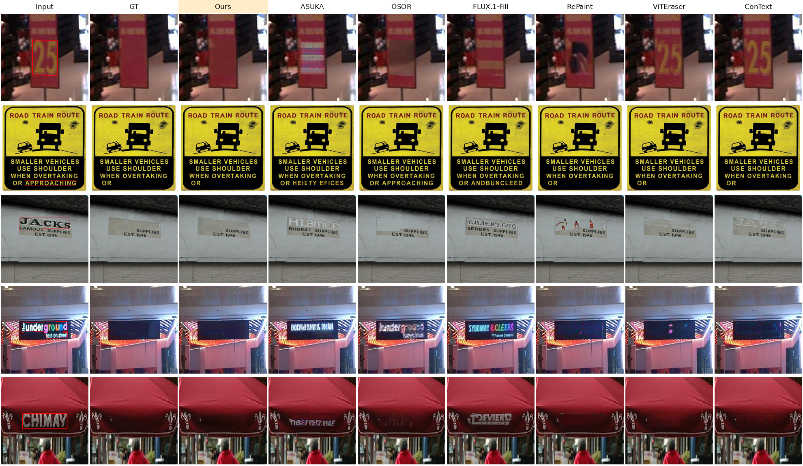

# RevealLayer-TextRemoval

Training-free, single-pass scene text removal built on
[RevealLayer](https://github.com/360CVGroup/RevealLayer) (ICML 2026).

RevealLayer decomposes an image into RGBA layers and recovers the content hidden behind each object. This repository
treats the text as the object and takes the recovered background as the text-free image. The pretrained RevealLayer
checkpoint is used unchanged. The method changes only the inference:

- **Separate inputs.** The text layer reads an image that contains only the text. The background reads a
  boundary-filled image.
- **Background keep.** The background layer is kept equal to the input outside the text.
- **Attention blocking.** The background layer cannot attend to the text tokens.

The text mask follows the text layer extracted at every denoising step, so one inference is enough. See
[docs/METHOD.md](docs/METHOD.md).

> This is a fork of [360CVGroup/RevealLayer](https://github.com/360CVGroup/RevealLayer). The upstream history is
> kept, and only the parts needed for text removal remain (see [Changes from upstream](#changes-from-upstream)).

## Results

SCUT-EnsText test set (813 images) with the official ViTEraser metrics and FID. The table shows the main setting:
the largest text region of each image is removed, and pixels outside it are taken from the GT (paste). The other
settings (raw output, all text, the 500-image subset with RePaint) are in [docs/RESULTS.md](docs/RESULTS.md).

| Method | PSNR↑ | MS-SSIM↑ | MSE↓ | AGE↓ | pEPS↓ | pCEPS↓ | FID↓ |
|---|---|---|---|---|---|---|---|
| Ours | 44.06 | 0.9921 | 0.00067 | 0.583 | 0.0064 | 0.0050 | 5.90 |
| ASUKA (FLUX.1-Fill) | 30.53 | 0.9743 | 0.00264 | 1.621 | 0.0180 | 0.0131 | 14.98 |
| OSOR | 39.06 | 0.9870 | 0.00129 | 0.961 | 0.0113 | 0.0087 | 7.61 |
| FLUX.1-Fill | 30.93 | 0.9726 | 0.00298 | 1.869 | 0.0208 | 0.0156 | 15.98 |
| ViTEraser | **48.58** | **0.9943** | **0.00016** | **0.285** | **0.0027** | **0.0017** | **3.19** |
| ConText | 42.23 | 0.9874 | 0.00050 | 0.481 | 0.0052 | 0.0030 | 8.34 |

Qualitative results (largest_text): the evaluated text is outlined in red in the input. The all_text figure is in
[docs/RESULTS.md](docs/RESULTS.md#qualitative-results).



<sub>Images: SCUT-EnsText test set, shown for research comparison only.</sub>

## Installation

Tested with Python 3.10, PyTorch 2.7.1 (CUDA 12.8) and NVIDIA Blackwell GPUs.

```bash
git clone https://github.com/ito127/research-project.git RevealLayer-TextRemoval
cd RevealLayer-TextRemoval
bash scripts/setup_env.sh            # conda env "reveallayer"; PYTORCH_CUDA=cu126 for older drivers
conda activate reveallayer
```

`setup_env.sh` installs PyTorch from the PyTorch index, then `requirements.txt` and the bundled `diffusers/`.

## Models

FLUX.1-dev is gated. Accept its license on
[Hugging Face](https://huggingface.co/black-forest-labs/FLUX.1-dev), then log in and download:

```bash
hf auth login
bash scripts/download_models.sh
```

This downloads [qihoo360/RevealLayer](https://huggingface.co/qihoo360/RevealLayer) and the diffusers-format folders
of [black-forest-labs/FLUX.1-dev](https://huggingface.co/black-forest-labs/FLUX.1-dev):

```text
models/
├── RevealLayer/        pytorch_lora_weights.safetensors, layer_pe.pt, Refiner.pt, xvae/transparent_decoder_ckpt.pth
└── FLUX.1-dev/         transformer/, vae/, text_encoder/, text_encoder_2/, tokenizer/, tokenizer_2/, scheduler/
```

Use `--models-dir` to point to checkpoints stored elsewhere.

## Usage

The input is an image and a binary text mask (white = text, same size as the image).

```bash
python scripts/remove_text.py --image path/to/image.jpg --mask path/to/mask.png \
    --scope all_text --output-dir outputs/demo --paste-back
```

`outputs/demo/<id>/` then contains the following files:

| File | Content |
|---|---|
| `bg_rgb.png` | text-free image at the RevealLayer resolution |
| `result.png` | (`--paste-back`) text-free image at the input size, with the input image outside the text mask |
| `text_layer_rgba.png` | extracted text layer |
| `metadata.json` | settings and timing |

`--scope largest_text` removes only the largest connected text region. `--save-intermediates` also saves the
per-step masks and clean-estimate previews.

For a dataset, pass a directory of images and a directory of same-named masks:

```bash
python scripts/remove_text.py --images-dir data/SCUT-EnsText/test/all_images \
    --masks-dir data/SCUT-EnsText/test/all_masks --scope largest_text \
    --output-dir outputs/scut_largest_text --shard 0 --num-shards 1
```

Samples that already have a result are skipped. Failures are written to `failed.txt` and the run continues.

## Evaluation

[eval/](eval) builds the SCUT-EnsText targets and runs the official ViTEraser metrics, FID, the result tables and
the qualitative figures. See [docs/RESULTS.md](docs/RESULTS.md#reproducing). The dataset is not included: download
[SCUT-EnsText](https://github.com/HCIILAB/SCUT-EnsText) and follow its license.

## Repository layout

```text
textremoval/      the method: inputs, per-step guidance, fills, model loading
scripts/          remove_text.py (inference), setup_env.sh, download_models.sh
eval/             SCUT-EnsText evaluation (targets, metrics, tables, figures)
models/           RevealLayer model code (with the changes below)
diffusers/        the diffusers copy bundled with RevealLayer (unchanged)
docs/             method and full results
tests/            CPU unit tests: python -m unittest discover -s tests
```

## Changes from upstream

- **Added to the model code:**
  - `models/custom_pipeline.py`: optional arguments `blocked_token_maps_callback`, `velocity_correction_callback`,
    `foreground_adapter_image` and `foreground_reference_image`.
  - `models/custom_model_mmdit.py`: the marked tokens are blocked from the background queries through the
    attention mask, and an optional extra full-image layer is added that only the object layers attend to.
- **Removed (not needed for text removal):**
  - the layer-decomposition inference and evaluation (`infer.py`, `infer.sh`, `eval.py`), the training configs
    (`configs/`), RevealLayerBench (`benchmark/`) and the upstream README figures;
  - the unused pipeline class and prompt helpers in `models/custom_pipeline.py`;
  - the training-only gradient checkpointing and unused helpers in `models/custom_model_mmdit.py`.
- **Simplified:**
  - The model loading and input geometry of `infer.py` now live in `textremoval/runtime.py`.
  - The transparent decoder (`models/custom_model_xvae.py`) no longer loads ImageNet ViT-B/32 weights first,
    because every weight comes from `transparent_decoder_ckpt.pth`.
  - `requirements.txt` drops `mmengine`, `xformers` and `flash-attn`; `scripts/setup_env.sh` installs PyTorch
    with an explicit CUDA build, and `scripts/download_models.sh` uses `hf download` (no git-lfs).
- `diffusers/` is unchanged.

## Citation

This work builds on RevealLayer. If you use this code, please cite:

```bibtex
@inproceedings{wang2026reveallayer,
  title={RevealLayer: Disentangling Hidden and Visible Layers via Occlusion-Aware Image Decomposition},
  author={Wang, Binhao and Zhao, Shihao and Cheng, Bo and Ji, Qiuyu and Ma, Yuhang and Wu, Liebucha and Liu, Shanyuan and Leng, Dawei and Yin, Yuhui},
  booktitle={International Conference on Machine Learning},
  year={2026}
}
```

## License

The code follows the upstream RevealLayer license (Apache License 2.0). The model weights have their own licenses;
in particular, FLUX.1-dev is distributed under the FLUX.1 [dev] Non-Commercial License.
