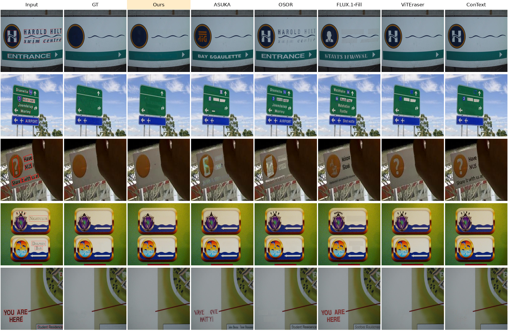

# Results on SCUT-EnsText

## Evaluation protocol

- **Data:** the SCUT-EnsText test set (813 images, 512×512). Masks are used as given (no dilation).
- **Text scope:**
  - **largest_text** (main setting): only the largest 8-connected component `L` of the text mask is removed. The GT
    is the official text-removed image inside `L` and the input image outside `L`.
  - **all_text:** every text is removed. The GT is the official GT.
- **Evaluation target:** each output is evaluated in two ways.

  | Target | Inside the evaluated text region | Outside it | What it measures |
  |---|---|---|---|
  | **paste** | method output | GT | the removal itself (main) |
  | **raw** | method output | method output | the removal and any change outside the text |

  The difference between the two is the damage a method does outside the text. Ours regenerates the whole image
  at 1024 px and resizes it back to 512 px, so its raw score includes the small differences this causes.
- **Metrics:** the official ViTEraser evaluation script (PSNR, MS-SSIM, MSE, AGE, pEPS, pCEPS) and pytorch-fid.
  **Bold** = best per column; the reference row "input image as is" is excluded from the best. `n` is the number
  of evaluated images. The official script skips an image whose output equals the GT (MSE = 0). img_324 has an
  empty text mask, so our output for it is the input image and it is skipped (paste: for every method).

## Compared methods

| Method | Type | Inference resolution | Seed | Results |
|---|---|---|---|---|
| Ours | RevealLayer, training-free (this repository) | 1024 → 512 (LANCZOS) | 43 | all |
| ASUKA (FLUX.1-Fill) | diffusion-based inpainting | 512 | 42 | all |
| OSOR | diffusion-based inpainting | 1024 (upscaled) | 42 | all |
| FLUX.1-Fill | diffusion-based inpainting | 1024 (upscaled) | 42 | all |
| RePaint | diffusion-based inpainting | 256 (crop around the text, pasted back) | 777 | largest_text, img_0–img_499 |
| ViTEraser | dedicated text removal model | 512 | – | erases every text |
| ConText | dedicated text removal model | 512 | – | erases every text |

- Ours and the inpainting baselines get the same text mask. ViTEraser and ConText take no mask: they find the text
  themselves and erase every text they find. Each result comes from a single seed.
- ViTEraser is trained on the SCUT-EnsText training set and evaluated on its test set. Our model and the
  diffusion-based inpainting baselines are not trained on SCUT-EnsText.
- ViTEraser and ConText erase every text in the image, so they have no largest_text raw result. Their largest_text
  paste result uses their output inside `L` only.
- RePaint was run on img_0–img_499 only (largest_text), so a separate 500-image subset table includes it.

## Quantitative results

### largest_text

All 813 images, paste:

| Method | PSNR↑ | MS-SSIM↑ | MSE↓ | AGE↓ | pEPS↓ | pCEPS↓ | FID↓ | n |
|---|---|---|---|---|---|---|---|---|
| Ours | 44.06 | 0.9921 | 0.00067 | 0.583 | 0.0064 | 0.0050 | 5.90 | 812 |
| ASUKA (FLUX.1-Fill) | 30.53 | 0.9743 | 0.00264 | 1.621 | 0.0180 | 0.0131 | 14.98 | 812 |
| OSOR | 39.06 | 0.9870 | 0.00129 | 0.961 | 0.0113 | 0.0087 | 7.61 | 812 |
| FLUX.1-Fill | 30.93 | 0.9726 | 0.00298 | 1.869 | 0.0208 | 0.0156 | 15.98 | 812 |
| ViTEraser | **48.58** | **0.9943** | **0.00016** | **0.285** | **0.0027** | **0.0017** | **3.19** | 812 |
| ConText | 42.23 | 0.9874 | 0.00050 | 0.481 | 0.0052 | 0.0030 | 8.34 | 812 |
| Input image as is (reference) | 29.75 | 0.9706 | 0.00370 | 2.043 | 0.0207 | 0.0153 | 17.90 | 812 |

All 813 images, raw:

| Method | PSNR↑ | MS-SSIM↑ | MSE↓ | AGE↓ | pEPS↓ | pCEPS↓ | FID↓ | n |
|---|---|---|---|---|---|---|---|---|
| Ours | **35.22** | **0.9826** | **0.00090** | 2.796 | **0.0100** | **0.0052** | **7.06** | 812 |
| ASUKA (FLUX.1-Fill) | 30.05 | 0.9733 | 0.00270 | **2.531** | 0.0186 | 0.0135 | 15.17 | 813 |
| OSOR | 29.90 | 0.9297 | 0.00292 | 4.755 | 0.0426 | 0.0150 | 12.91 | 813 |
| FLUX.1-Fill | 27.63 | 0.9533 | 0.00349 | 5.535 | 0.0305 | 0.0158 | 18.48 | 813 |

img_0–img_499, paste (with RePaint):

| Method | PSNR↑ | MS-SSIM↑ | MSE↓ | AGE↓ | pEPS↓ | pCEPS↓ | FID↓ | n |
|---|---|---|---|---|---|---|---|---|
| Ours | 45.37 | 0.9939 | 0.00041 | 0.417 | 0.0046 | 0.0035 | 6.61 | 499 |
| ASUKA (FLUX.1-Fill) | 30.95 | 0.9780 | 0.00250 | 1.489 | 0.0166 | 0.0125 | 18.46 | 499 |
| OSOR | 39.85 | 0.9888 | 0.00120 | 0.869 | 0.0102 | 0.0081 | 9.16 | 499 |
| FLUX.1-Fill | 32.10 | 0.9777 | 0.00279 | 1.720 | 0.0189 | 0.0149 | 18.61 | 499 |
| RePaint | 40.82 | 0.9905 | 0.00102 | 0.727 | 0.0085 | 0.0069 | 11.47 | 499 |
| ViTEraser | **50.05** | **0.9956** | **0.00011** | **0.211** | **0.0019** | **0.0012** | **3.66** | 499 |
| ConText | 44.27 | 0.9912 | 0.00025 | 0.310 | 0.0032 | 0.0018 | 8.89 | 499 |

img_0–img_499, raw (with RePaint):

| Method | PSNR↑ | MS-SSIM↑ | MSE↓ | AGE↓ | pEPS↓ | pCEPS↓ | FID↓ | n |
|---|---|---|---|---|---|---|---|---|
| Ours | **35.97** | **0.9856** | **0.00063** | 2.587 | **0.0076** | **0.0037** | **8.01** | 499 |
| ASUKA (FLUX.1-Fill) | 30.36 | 0.9767 | 0.00259 | 2.517 | 0.0175 | 0.0132 | 18.76 | 500 |
| OSOR | 30.49 | 0.9412 | 0.00243 | 4.237 | 0.0385 | 0.0128 | 15.90 | 500 |
| FLUX.1-Fill | 28.39 | 0.9605 | 0.00326 | 5.315 | 0.0276 | 0.0151 | 22.04 | 500 |
| RePaint | 35.51 | 0.9616 | 0.00144 | **2.180** | 0.0219 | 0.0079 | 15.79 | 500 |

- **paste:** ours is second after ViTEraser in PSNR, MS-SSIM and FID, and third after ViTEraser and ConText in
  MSE, AGE, pEPS and pCEPS. It is better than every diffusion-based inpainting baseline in all metrics, on all
  813 images and on the 500-image subset.
- **raw:** among the methods with a largest_text raw result, ours is best in all metrics except AGE (ASUKA on all
  images, RePaint on the subset). AGE averages the absolute grey-level error over the whole image, so the small
  brightness differences that our 1024 px regeneration leaves outside `L` likely count against it.

### all_text

All 813 images, paste:

| Method | PSNR↑ | MS-SSIM↑ | MSE↓ | AGE↓ | pEPS↓ | pCEPS↓ | FID↓ | n |
|---|---|---|---|---|---|---|---|---|
| Ours | 37.37 | 0.9808 | 0.00178 | 1.328 | 0.0147 | 0.0110 | 17.87 | 812 |
| ASUKA (FLUX.1-Fill) | 32.30 | 0.9661 | 0.00225 | 1.689 | 0.0195 | 0.0127 | 27.05 | 812 |
| OSOR | 34.09 | 0.9686 | 0.00274 | 2.031 | 0.0248 | 0.0185 | 24.69 | 812 |
| FLUX.1-Fill | 30.90 | 0.9586 | 0.00321 | 2.360 | 0.0276 | 0.0194 | 35.51 | 812 |
| ViTEraser | **43.79** | **0.9889** | **0.00027** | **0.495** | **0.0043** | **0.0025** | **8.14** | 812 |
| ConText | 37.34 | 0.9751 | 0.00086 | 0.853 | 0.0090 | 0.0046 | 22.69 | 812 |
| Input image as is (reference) | 26.64 | 0.9405 | 0.00649 | 3.650 | 0.0372 | 0.0256 | 52.18 | 812 |

All 813 images, raw:

| Method | PSNR↑ | MS-SSIM↑ | MSE↓ | AGE↓ | pEPS↓ | pCEPS↓ | FID↓ | n |
|---|---|---|---|---|---|---|---|---|
| Ours | 30.67 | 0.9567 | 0.00308 | 4.432 | 0.0275 | 0.0183 | 21.95 | 813 |
| ASUKA (FLUX.1-Fill) | 30.44 | 0.9521 | 0.00258 | 3.158 | 0.0229 | 0.0145 | 29.12 | 813 |
| OSOR | 27.32 | 0.9039 | 0.00542 | 6.627 | 0.0647 | 0.0323 | 30.74 | 813 |
| FLUX.1-Fill | 27.24 | 0.9320 | 0.00390 | 6.103 | 0.0390 | 0.0211 | 38.15 | 813 |
| ViTEraser | **37.11** | **0.9761** | **0.00047** | **1.703** | **0.0066** | **0.0035** | **10.16** | 813 |
| ConText | 34.08 | 0.9620 | 0.00109 | 1.938 | 0.0114 | 0.0058 | 24.33 | 813 |
| Input image as is (reference) | 26.01 | 0.9277 | 0.00676 | 4.697 | 0.0400 | 0.0270 | 53.22 | 813 |

- **paste:** ours is second after ViTEraser in PSNR (37.37 dB, close to ConText's 37.34 dB), MS-SSIM and FID, and
  third after ViTEraser and ConText in the other metrics. It is better than every diffusion-based inpainting
  baseline in all metrics, the same ranking as in largest_text.
- **raw:** ours is third in PSNR and MS-SSIM, second in FID and fourth (behind ASUKA as well) in MSE, AGE, pEPS and
  pCEPS. With more text per image, both the errors inside the mask and the changes outside it weigh more than in
  largest_text.
- The paste PSNR gap to ViTEraser grows from 4.5 dB (largest_text) to 6.4 dB (all_text).

## Per-image PSNR

PSNR inside the evaluated text region, per image (paste targets; `eval/qualitative.py` writes it to
`per_image_psnr.csv`). "Best on" counts the images on which a method has the highest PSNR of all methods.

**largest_text**, img_0–img_499 (all seven methods; img_324 excluded, 499 images):

| Method | Median [dB] | Mean [dB] | Below 12 dB | Best on |
|---|---|---|---|---|
| Ours | 29.39 | 27.91 | 3.4% | 57 |
| ASUKA (FLUX.1-Fill) | 12.68 | 13.50 | 42.7% | 2 |
| OSOR | 22.13 | 22.39 | 14.2% | 40 |
| FLUX.1-Fill | 13.51 | 14.64 | 35.9% | 2 |
| RePaint | 22.53 | 23.36 | 9.4% | 34 |
| ViTEraser | 33.74 | 32.59 | 0.8% | 345 |
| ConText | 28.51 | 26.81 | 3.6% | 19 |

**all_text**, all images (six methods; img_324 excluded, 812 images):

| Method | Median [dB] | Mean [dB] | Below 12 dB | Best on |
|---|---|---|---|---|
| Ours | 24.53 | 23.93 | 9.7% | 73 |
| ASUKA (FLUX.1-Fill) | 17.34 | 18.86 | 15.8% | 21 |
| OSOR | 19.65 | 20.65 | 18.0% | 53 |
| FLUX.1-Fill | 16.18 | 17.45 | 20.1% | 12 |
| ViTEraser | 30.93 | 30.35 | 0.5% | 619 |
| ConText | 23.97 | 23.90 | 4.7% | 34 |

Ours has the second-highest median in both scopes. In all_text it has more images with a low PSNR (9.7% below
12 dB, against 3.4% in largest_text).

## Qualitative results

The images are ranked by our PSNR inside the evaluated text minus that of the best other method (paste targets).
Only images whose evaluated text has at least 1500 pixels are considered, so the region is visible. The five
images with the largest margin are shown. They are the cases where ours leads most, not typical ones; the overall
distribution is in [Per-image PSNR](#per-image-psnr). Each cell is a crop around the evaluated text, which is outlined in red in
the input. The figures use `eval/qualitative.py`. Images: SCUT-EnsText test set, shown for research comparison only.

**largest_text** (img_0–img_499, with RePaint):


**all_text** (all 813 images):



## Reproducing

```bash
# 1. Our results (one GPU; shard with --shard/--num-shards over several GPUs)
python scripts/remove_text.py --images-dir data/SCUT-EnsText/test/all_images \
    --masks-dir data/SCUT-EnsText/test/all_masks --scope largest_text --output-dir outputs/scut_largest_text

# 2. Targets: add every other method's outputs with --method NAME='path/{id}.png'
python eval/build_targets.py --scut-root data/SCUT-EnsText/test --scope largest_text \
    --workdir eval_runs/largest_text --ours outputs/scut_largest_text

# 3. Metrics and tables (eval_runs/largest_text/results.md)
VITERASER_ROOT=/path/to/ViTEraser GPU=0 bash eval/run_eval.sh eval_runs/largest_text

# 4. Per-image PSNR and qualitative figures
python eval/qualitative.py --workdir eval_runs/largest_text \
    --images-dir data/SCUT-EnsText/test/all_images --methods ours osor viteraser
```
