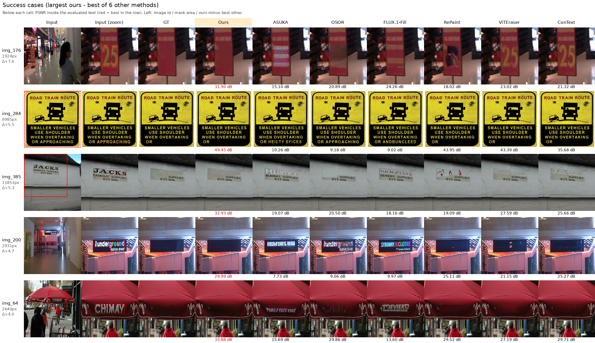
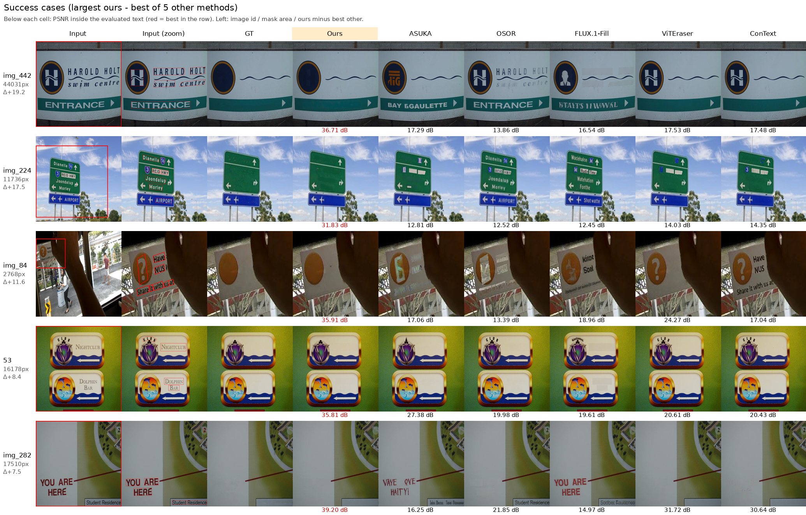

# Results on SCUT-EnsText

SCUT-EnsText test set (813 images, 512×512). We use the official ViTEraser evaluation script (PSNR, MS-SSIM, MSE,
AGE, pEPS, pCEPS) and pytorch-fid. **Bold** = best per column. The reference row "input image as is" is excluded
from the best.

- **largest_text** (main setting): only the largest 8-connected component `L` of the text mask is removed. The GT is
  the official text-removed image inside `L` and the input image outside `L`.
- **all_text**: every text is removed. The GT is the official GT.
- **paste**: the method's output inside the evaluated text region, the GT outside it. This compares only the
  removal itself.
- **raw**: the output as is, so degradation outside the text region is also counted.

Settings of the compared methods:

- Our results are produced at 1024 px and resized back to 512 px (LANCZOS).
- ViTEraser and ConText erase every text in the image, so they have no largest_text raw result.
- RePaint was run on img_0–img_499 only (largest_text).
- img_324 has an empty text mask. Our output for it is therefore the input image, and the official script skips it
  (MSE = 0).

`n` = number of evaluated images.

## largest_text

All 813 images, paste:

| Method | PSNR↑ | MS-SSIM↑ | MSE↓ | AGE↓ | pEPS↓ | pCEPS↓ | FID↓ | n |
|---|---|---|---|---|---|---|---|---|
| Ours | 44.06 | 0.9921 | 0.00067 | 0.583 | 0.0064 | 0.0050 | 5.90 | 812 |
| ASUKA (FLUX.1-Fill) | 30.53 | 0.9743 | 0.00264 | 1.621 | 0.0180 | 0.0131 | 14.98 | 812 |
| OSOR | 39.06 | 0.9870 | 0.00129 | 0.961 | 0.0113 | 0.0087 | 7.61 | 812 |
| FLUX.1-Fill | 30.93 | 0.9726 | 0.00298 | 1.869 | 0.0208 | 0.0156 | 15.98 | 812 |
| ViTEraser | **48.58** | **0.9943** | **0.00016** | **0.285** | **0.0027** | **0.0017** | **3.19** | 812 |
| ConText | 42.23 | 0.9874 | 0.00050 | 0.481 | 0.0052 | 0.0030 | 8.34 | 812 |
| Input image as is (reference) | 29.75 | 0.9706 | 0.00370 | 2.043 | 0.0207 | 0.0153 | 17.90 | 812 |

All 813 images, raw:

| Method | PSNR↑ | MS-SSIM↑ | MSE↓ | AGE↓ | pEPS↓ | pCEPS↓ | FID↓ | n |
|---|---|---|---|---|---|---|---|---|
| Ours | **35.22** | **0.9826** | **0.00090** | 2.796 | **0.0100** | **0.0052** | **7.06** | 812 |
| ASUKA (FLUX.1-Fill) | 30.05 | 0.9733 | 0.00270 | **2.531** | 0.0186 | 0.0135 | 15.17 | 813 |
| OSOR | 29.90 | 0.9297 | 0.00292 | 4.755 | 0.0426 | 0.0150 | 12.91 | 813 |
| FLUX.1-Fill | 27.63 | 0.9533 | 0.00349 | 5.535 | 0.0305 | 0.0158 | 18.48 | 813 |

img_0–img_499, paste (with RePaint):

| Method | PSNR↑ | MS-SSIM↑ | MSE↓ | AGE↓ | pEPS↓ | pCEPS↓ | FID↓ | n |
|---|---|---|---|---|---|---|---|---|
| Ours | 45.37 | 0.9939 | 0.00041 | 0.417 | 0.0046 | 0.0035 | 6.61 | 499 |
| ASUKA (FLUX.1-Fill) | 30.95 | 0.9780 | 0.00250 | 1.489 | 0.0166 | 0.0125 | 18.46 | 499 |
| OSOR | 39.85 | 0.9888 | 0.00120 | 0.869 | 0.0102 | 0.0081 | 9.16 | 499 |
| FLUX.1-Fill | 32.10 | 0.9777 | 0.00279 | 1.720 | 0.0189 | 0.0149 | 18.61 | 499 |
| RePaint | 40.82 | 0.9905 | 0.00102 | 0.727 | 0.0085 | 0.0069 | 11.47 | 499 |
| ViTEraser | **50.05** | **0.9956** | **0.00011** | **0.211** | **0.0019** | **0.0012** | **3.66** | 499 |
| ConText | 44.27 | 0.9912 | 0.00025 | 0.310 | 0.0032 | 0.0018 | 8.89 | 499 |

img_0–img_499, raw (with RePaint):

| Method | PSNR↑ | MS-SSIM↑ | MSE↓ | AGE↓ | pEPS↓ | pCEPS↓ | FID↓ | n |
|---|---|---|---|---|---|---|---|---|
| Ours | **35.97** | **0.9856** | **0.00063** | 2.587 | **0.0076** | **0.0037** | **8.01** | 499 |
| ASUKA (FLUX.1-Fill) | 30.36 | 0.9767 | 0.00259 | 2.517 | 0.0175 | 0.0132 | 18.76 | 500 |
| OSOR | 30.49 | 0.9412 | 0.00243 | 4.237 | 0.0385 | 0.0128 | 15.90 | 500 |
| FLUX.1-Fill | 28.39 | 0.9605 | 0.00326 | 5.315 | 0.0276 | 0.0151 | 22.04 | 500 |
| RePaint | 35.51 | 0.9616 | 0.00144 | **2.180** | 0.0219 | 0.0079 | 15.79 | 500 |

## all_text

All 813 images, paste:

| Method | PSNR↑ | MS-SSIM↑ | MSE↓ | AGE↓ | pEPS↓ | pCEPS↓ | FID↓ | n |
|---|---|---|---|---|---|---|---|---|
| Ours | 37.37 | 0.9808 | 0.00178 | 1.328 | 0.0147 | 0.0110 | 17.87 | 812 |
| ASUKA (FLUX.1-Fill) | 32.30 | 0.9661 | 0.00225 | 1.689 | 0.0195 | 0.0127 | 27.05 | 812 |
| OSOR | 34.09 | 0.9686 | 0.00274 | 2.031 | 0.0248 | 0.0185 | 24.69 | 812 |
| FLUX.1-Fill | 30.90 | 0.9586 | 0.00321 | 2.360 | 0.0276 | 0.0194 | 35.51 | 812 |
| ViTEraser | **43.79** | **0.9889** | **0.00027** | **0.495** | **0.0043** | **0.0025** | **8.14** | 812 |
| ConText | 37.34 | 0.9751 | 0.00086 | 0.853 | 0.0090 | 0.0046 | 22.69 | 812 |
| Input image as is (reference) | 26.64 | 0.9405 | 0.00649 | 3.650 | 0.0372 | 0.0256 | 52.18 | 812 |

All 813 images, raw:

| Method | PSNR↑ | MS-SSIM↑ | MSE↓ | AGE↓ | pEPS↓ | pCEPS↓ | FID↓ | n |
|---|---|---|---|---|---|---|---|---|
| Ours | 30.67 | 0.9567 | 0.00308 | 4.432 | 0.0275 | 0.0183 | 21.95 | 813 |
| ASUKA (FLUX.1-Fill) | 30.44 | 0.9521 | 0.00258 | 3.158 | 0.0229 | 0.0145 | 29.12 | 813 |
| OSOR | 27.32 | 0.9039 | 0.00542 | 6.627 | 0.0647 | 0.0323 | 30.74 | 813 |
| FLUX.1-Fill | 27.24 | 0.9320 | 0.00390 | 6.103 | 0.0390 | 0.0211 | 38.15 | 813 |
| ViTEraser | **37.11** | **0.9761** | **0.00047** | **1.703** | **0.0066** | **0.0035** | **10.16** | 813 |
| ConText | 34.08 | 0.9620 | 0.00109 | 1.938 | 0.0114 | 0.0058 | 24.33 | 813 |
| Input image as is (reference) | 26.01 | 0.9277 | 0.00676 | 4.697 | 0.0400 | 0.0270 | 53.22 | 813 |

## Qualitative results

Per-image PSNR inside the evaluated text of the paste targets. Only images whose evaluated text has at least
1500 pixels are considered, so the region is visible.

- **Success**: the five images where our PSNR minus the best other method is largest.

The figures use `eval/qualitative.py`. Images: SCUT-EnsText test set, shown for research comparison only.

**largest_text** (img_0–img_499, with RePaint):



**all_text** (all 813 images):



## Reproducing

```bash
# 1. Our results (one GPU; shard with --shard/--num-shards over several GPUs)
python scripts/remove_text.py --images-dir data/SCUT-EnsText/test/all_images \
    --masks-dir data/SCUT-EnsText/test/all_masks --scope largest_text --output-dir outputs/scut_largest_text

# 2. Targets: add every other method's outputs with --method NAME='path/{id}.png'
python eval/build_targets.py --scut-root data/SCUT-EnsText/test --scope largest_text \
    --workdir eval_runs/largest_text --ours outputs/scut_largest_text

# 3. Metrics and tables (eval_runs/largest_text/results.md)
VITERASER_ROOT=/path/to/ViTEraser GPU=0 bash eval/run_eval.sh eval_runs/largest_text

# 4. Per-image PSNR and qualitative figures
python eval/qualitative.py --workdir eval_runs/largest_text \
    --images-dir data/SCUT-EnsText/test/all_images --methods ours osor viteraser
```
